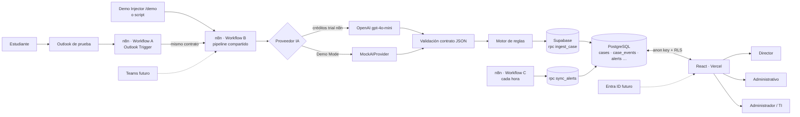

# Arquitectura implementada

## Módulos (NFR-005)

| Capa | Implementación | Ubicación |
|---|---|---|
| Ingesta | Webhook n8n (B), Outlook Trigger (A), scripts CLI, Demo Injector | `n8n/`, `scripts/ingest.ts`, `app/src/demo` |
| Normalización y alcance | `normalizeMessage`, `checkScope` (HTML→texto, límites, programa por buzón, dominios del piloto) | `core/src/normalize.ts` |
| Análisis IA | Prompt anti-inyección + contrato estricto; OpenAI (nodo n8n / `OpenAIProvider`) o `MockAIProvider` | `core/src/aiContract.ts`, `core/src/mockAi.ts`, `core/src/pipeline.ts` |
| Reglas | `evaluatePriority` PRIORITY-01…09 con parámetros de `app_config` | `core/src/rules.ts` |
| SLA y alertas | Días hábiles, ALERT-001…005; sincronización sin duplicados en SQL | `core/src/businessDays.ts`, `core/src/alerts.ts`, `sync_alerts` |
| Persistencia | RPC transaccionales, triggers de auditoría, RLS | `supabase/migrations` |
| Presentación | React: Dashboard, Bandeja, Detalle, Alertas, Admin, Demo | `app/src` |

**Una sola fuente de lógica:** `core/` se empaqueta con esbuild dentro de los nodos Code de n8n (`npm run build:n8n`), se
importa en el frontend (alias `@core`) y en los scripts. Las pruebas unitarias cubren el mismo código que ejecuta n8n;
`npm run eval -- ` y `npm run eval:n8n -- --provider mock` producen resultados idénticos (verificado).

## Flujo de datos de un caso

1. `POST /webhook/student-request-demo` (o correo en Outlook → Workflow A → mismo webhook).
2. Se lee `app_config` (umbrales, programas, proveedor IA) — los cambios en `/admin` aplican al siguiente mensaje.
3. Normalización + alcance; fuera del piloto → `ops_log`, sin caso.
4. Idempotencia: `find_case_by_source(source_message_id)`; duplicado → respuesta con el caso existente, sin gastar créditos de IA.
5. IA → validación del contrato → reglas → `ingest_case` (un único `INSERT` transaccional de caso + `classification_runs` + eventos `case_created`, `classification_completed|failed`, `status_change received→classified`).
6. Alertas iniciales (fecha límite < 24 h, sensible pendiente) → `sync_alerts`.
7. La bandeja muestra el caso ordenado por prioridad, fecha límite y antigüedad.
8. Acciones humanas vía RPC (`update_case`, `accept_suggestion`, `add_case_note`, `acknowledge_alert`) → triggers de auditoría.
9. Workflow C recalcula SLA cada hora; `case_metrics` alimenta el dashboard.

## Seguridad

- Navegador: sólo `anon key`; todo acceso a datos filtrado por RLS según `profiles.role` y programa.
- n8n y scripts: `service_role` guardada como credencial n8n / variable de entorno, nunca en el repositorio ni en `VITE_*`.
- Escritura de casos sólo por RPC `SECURITY DEFINER` que validan rol, campos permitidos, categoría/responsable existentes y transición.
- Correos tratados como datos no confiables (prompt + delimitadores `<student_message>` + validación de salida).
- Logs técnicos (`ops_log`) no guardan el cuerpo del mensaje.
