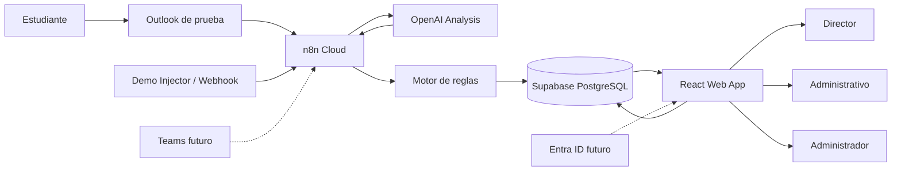

# 04 — Arquitectura técnica

## Arquitectura objetivo



## Responsabilidades

### Outlook
Entrada realista del MVP cuando existan credenciales.

### Demo Injector
Fallback obligatorio para reproducibilidad.

### n8n
- trigger;
- validación;
- normalización;
- llamada a IA;
- aplicación o invocación de reglas;
- persistencia;
- alertas;
- manejo de errores.

### OpenAI
Interpretación de texto:
- categoría;
- resumen;
- urgencia;
- fechas;
- impacto;
- responsable sugerido;
- sensibilidad;
- confianza.

### Motor de reglas
Convierte señales en prioridad operacional.

Preferencia de implementación:
1. Code node de n8n para MVP si la lógica es pequeña.
2. FastAPI únicamente si aumenta complejidad o se necesita test unitario más limpio.

### Supabase
Fuente central de verdad.

### React
Bandeja, detalle, métricas y administración.

## Arquitectura de implementación recomendada

```text
repo/
├── app/                         # React + TypeScript
│   ├── src/
│   │   ├── components/
│   │   ├── pages/
│   │   ├── features/
│   │   │   ├── cases/
│   │   │   ├── dashboard/
│   │   │   ├── alerts/
│   │   │   └── admin/
│   │   ├── lib/
│   │   ├── types/
│   │   └── demo/
│   └── ...
├── n8n/
│   ├── workflow_ingest_outlook.json
│   ├── workflow_ingest_webhook.json
│   ├── workflow_followup_alerts.json
│   └── README.md
├── supabase/
│   ├── migrations/
│   ├── seed.sql
│   └── README.md
├── backend/                     # opcional
│   └── ...
├── tests/
├── docs/
├── .env.example
└── README.md
```

## Demo Mode

`DEMO_MODE=true`:

- permite inyectar mensajes sintéticos;
- puede utilizar `MockAIProvider`;
- conserva exactamente el mismo output contract;
- no debe cambiar la lógica de reglas;
- permite repetir pruebas sin costo o credenciales.

## Decisión clave

El MVP debe poder demostrar valor incluso si:
- Microsoft Graph no está disponible;
- la cuenta de Outlook no puede conectarse;
- no hay acceso institucional;
- OpenAI temporalmente no está disponible.

Eso se logra desacoplando fuente de mensaje y proveedor de IA.
